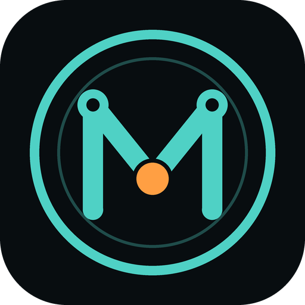

<div align="center">



# Molly Controller

**The handheld for [Molly](https://github.com/DarmawanRobotics/Molly), the tour guide robot on a
Deep Robotics Lite3: drive it, map a site with its AprilTags and points of interest, build tours,
guide visitors and talk with them, from a Retroid Pocket 4 or any Android device in landscape.**

[](https://github.com/DarmawanRobotics/MollyController/actions/workflows/ci.yml)


[](LICENSE)

[Features](#features) · [Install](#install) · [Robot side](#robot-side) ·
[Configuration](#configuration) · [Protocol](#protocol) · [Controls](#controls) ·
[A site, step by step](#a-site-step-by-step) · [Develop](#develop)

</div>

---

The app talks Molly's UDP teleop protocol v1 (`molly-1`, port 9880) straight to the robot's
`teleop_udp_node`
([PROTOCOL.md](https://github.com/DarmawanRobotics/Molly/blob/main/src/molly_bridge/PROTOCOL.md)),
and takes the video over WebRTC. There is no ROS on the handheld. It started from
[Pashupati Controller](https://github.com/DarmawanRobotics/PashupatiController) 2.6.1 and keeps its
driving, video and safety.

## Features

**Drive**
- Physical sticks only: left stick drives and strafes, right stick turns. The touch screen is
  left free for the map.
- AUTO / REMOTE switch, three speed levels, and the Lite3's own commands as icons: stand up, sit
  down, gaits, walk and pose mode, step in place, gestures, ... Anything that drops the robot or
  hands its control away asks first.
- **STOP** is the software e-stop. It is released only by holding the button for a second.

**See**
- Two views, camera and map: one big and one small, swapped with a tap.
- Camera as H.264 over WebRTC, about 0.1 s behind live, or JPEG frames over the teleop link when
  WebRTC is unavailable. AprilTags and detected people are boxed on the video.
- The map shows the site's occupancy map, its points of interest with their names, the path the
  robot found (or the loaded route), the robot's trail, the lidar and the robot. Pinch to zoom,
  drag to move, twist to rotate, or let the map turn with the robot. A long press on the map
  sends the robot walking there.

**Map a site** (Map page)
- The robot's sites: load one, map a new one or extend the active map, then save it.
- Record the AprilTags in view and localize from them.
- Points of interest where the robot stands: a name, what the robot says there (Indonesian,
  English or the robot's default), a gesture and how long it stays. Add them here or with the POI
  icon on the main screen; edit them, move them to the robot or delete them here.
- Tours: the stops in order and where the robot walks back to.
- Routes (teach and repeat) are still there: record one, mark its stop points, load it.

**Guide** (Guide page and the main screen)
- Start a tour, or a tour of every point of interest, or walk to one of them.
- While a tour runs, a card on the main screen shows the stop, the place and what the robot does
  (walking, talking, a gesture, waiting for visitors), with pause / resume, next stop and end.
- Walking speed and person detection.

**Talk** (Talk page)
- Say anything typed, or a quick phrase (welcome, follow me, please wait, excuse me, questions,
  thank you, goodbye), in Indonesian or English, after what the robot is saying or cutting in.
- What the robot says now and what waits after it, with a button to stop it.
- Ask the robot a visitor's question and read its answer, said aloud or not.
- The greeter (greets visitors who come close) and a greeting now; the robot's gestures.
- The visitors around the robot: how many, in front, behind (following the tour) and the nearest.

**Monitor**
- Battery, link quality, protective field, health and the localization source (AprilTag, pose or
  the map origin).
- At a glance under the small view: what the robot says, the visitors and how many follow it, the
  greeter, the people in view and the robot's CPU, GPU and RAM.

**Everything else**
- Finds robots on the LAN by itself, with their active site, and connects with a token.
- Indonesian and English.

## Install

**From CI (no Flutter needed).** Every push to `main` builds a release APK.

1. Open [Actions](https://github.com/DarmawanRobotics/MollyController/actions/workflows/ci.yml)
   and pick the latest green run.
2. Download the `molly-controller-apk` artifact.
3. Unzip it and install the APK:

```bash
adb uninstall com.darmawanrobotics.molly_controller   # only when switching from a locally built APK
adb install app-release.apk
```

**From source.** You need Flutter 3.35 or newer, and the handheld on USB showing in `adb devices`.

```bash
git clone git@github.com:DarmawanRobotics/MollyController.git && cd MollyController
flutter pub get
flutter build apk --release
adb install -r build/app/outputs/flutter-apk/app-release.apk     # or: flutter run --release
```

APKs built locally are signed with your debug key, and the CI ones with the CI key. Android only
updates an app in place with the same key, so when you switch between the two, uninstall first.
Uninstalling clears the app's settings.

**First connection.** On the start screen, tap the version three times to open the connection
settings. Enter the address of the robot's Jetson (default `192.168.1.110:9880`) and its token.
Robots on the same network also show up in the list by themselves.

## Configuration

All settings live on the handheld (shared preferences) and apply at once.

| Setting | Default | Where |
|---|---|---|
| Robot address | `192.168.1.110` | start screen, tap the version three times |
| Port | `9880` | same |
| Token | empty (must match `teleop_udp_node.token`) | same |
| Handheld name | `Retroid` | same |
| Language | Indonesian (`id`) | Settings |
| Video, frame rate | on, 8 fps | Settings |
| Stop point wait | 10 s | Settings |

## Protocol

UDP, protocol Molly v1 (`molly-1`), port 9880, binary stream frames start with `MLY1`. The full
spec is [PROTOCOL.md](https://github.com/DarmawanRobotics/Molly/blob/main/src/molly_bridge/PROTOCOL.md)
in the Molly repo; the app side is `lib/protocol/` and `lib/net/teleop_client.dart`.

## Robot side

The token and the action icons come from the robot's `/etc/molly/site.yaml`. On the Lite3, the
action icons are the Trigger services of
[lite3_ros2](https://github.com/DarmawanRobotics/lite3_ros2):

```yaml
teleop_udp_node:
  ros__parameters:
    token: "<secret>"           # the same in the app
    robot_commands: [stand_up, sit_down, move_mode, pose_mode, gait_slow, gait_medium, gait_fast,
                     gait_crawl, gait_high_step, keep_stepping_on, keep_stepping_off, hello,
                     emergency_stop]
```

The rest follows what the robot runs. The pages use the commands listed in the robot's `welcome`
(sites and mapping, the path finder, tours, speech, the greeter, questions, gestures) and grey out
or explain what a robot does not offer. Two extras are switched in `/etc/molly/molly.env`:

| Feature | On the robot | In the app |
|---|---|---|
| WebRTC video | `WEBRTC=true`, `script/setup.sh install webrtc` (MediaMTX) | smooth video; JPEG without it |
| Person detection | `PEOPLE=true`, `script/setup.sh install people_model` | people count and boxes on the video |

## Controls

| | Gamepad | Touch |
|---|---|---|
| Drive and strafe | left stick | |
| Turn | right stick | |
| STOP (software e-stop) | B, on every page | red button |
| AUTO / REMOTE | Start | switch on top |
| Swap camera and map | Select | tap the small view |
| Speed level (30 / 60 / 100 % of the robot's limits) | D-pad up / down | Settings, Speed |
| Robot actions | L1 + A stand up, L1 + Y sit down | icons under STOP |
| Map | | pinch, drag, twist; double tap follows the robot |
| Walk somewhere | | long press on the big map |

The robot only takes the joystick in REMOTE; in AUTO, navigation drives. After a STOP, nothing
but zero reaches the robot until *Hold to release* is held for a second.

The icons at the bottom: **Map** (the Map page), **POI** (a point of interest here), **Tags**,
then **Localize**, **Guide**, **Start / Pause / Resume** and **End**, then **Talk**. While a route
is recorded, Map and POI make room for **Finish** and **Point**.

## A site, step by step

1. Switch to REMOTE, open **Map** and tap *New map*. Give the site a name (`lobby_east`).
2. Drive through the whole place. Stand still in view of every AprilTag and tap **Tags**. At every
   point of interest tap **POI**, name it and write what the robot says there.
3. On the Map page, tap *Save map*.
4. Make the tours on the Map page: tap *New tour*, tap the stops in order, pick where the robot
   walks back to.
5. Stand in view of an AprilTag and tap **Localize**. Switch to AUTO, open **Guide** and start a
   tour, or long press the map to walk anywhere.
6. Open **Talk** to speak to the visitors, answer their questions or turn the greeter on.

**Settings** (gear) apply at once: speed level, R1 to drive, video, lidar on the map, robot load
on screen, language, and how long the robot waits at a route stop point. A gamepad test is there
too.

## Develop

```
lib/
├── protocol/   messages.dart (JSON of the teleop protocol), streams.dart (camera, lidar, route,
│               map and site streams)
├── net/        teleop_client.dart (session, commands, joystick, map and site), discovery.dart,
│               webrtc_video.dart + whep.dart (camera over WebRTC)
├── input/      gamepad_input.dart (gamepads, normalized)
├── widgets/    hud, camera (tag and person boxes), map (+ map_image), glance, tour card,
│               POI and tour dialogs, page header
├── screens/    connect, drive (home), site (Map page), guide, interaction (Talk page), routes,
│               settings
├── robot_actions.dart   icons and labels of the Lite3 commands and gestures
└── l10n.dart            Indonesian and English text
```

```bash
flutter analyze
flutter test                  # protocol, decoders, widgets and pages at Retroid Pocket size
```

CI runs on every push. It analyzes the code, runs the tests and turns failures into annotations,
reports formatting, and builds the release APK. Bump `version` in `pubspec.yaml` with every
release, and note it in [CHANGELOG.md](CHANGELOG.md). When a dependency changes, commit the
`pubspec.lock` that `flutter pub get` writes.

Barlow Semi Condensed is under the SIL Open Font License (`assets/fonts/OFL.txt`). The app is
released under the [Apache License 2.0](LICENSE).
